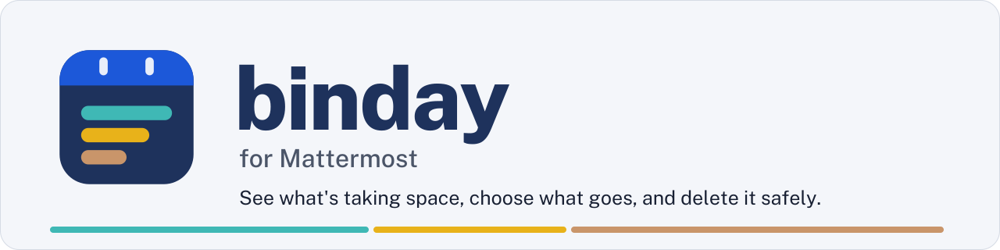
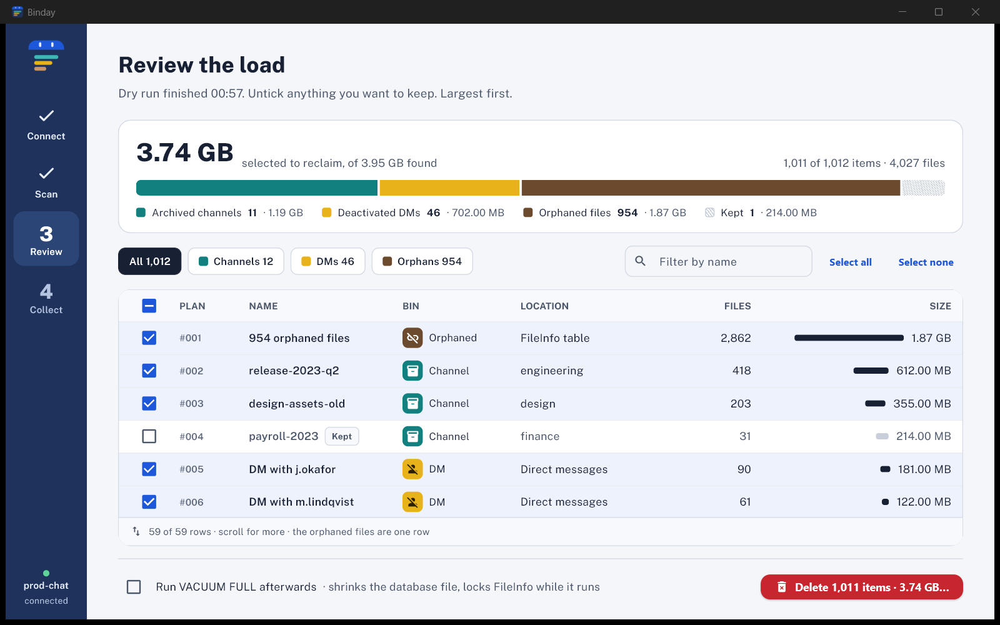
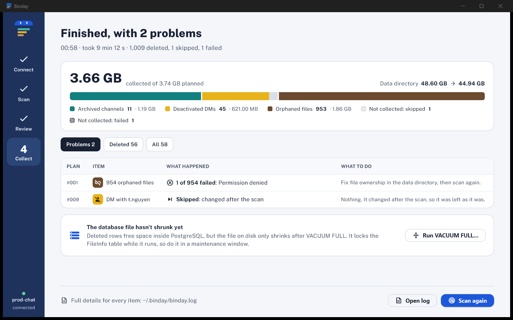

  <picture>
    <source media="(prefers-color-scheme: dark)" srcset="assets/readme/banner-dark.svg">
    
  </picture>

  
  
  
   
  
  
  

  <b><a href="https://github.com/zaryabmustafa/binday/releases/latest">Download</a></b> ·
  <a href="#get-started">Get started</a> ·
  <a href="docs/how-it-works.md">How it works</a> ·
  <a href="#is-it-safe">Safety</a> ·
  <a href="#faq">FAQ</a> ·
  <a href="docs/cli.md">Command line</a>

**Binday** is a free, open-source desktop app that frees disk space on a **self-hosted Mattermost** server. It finds the data Mattermost leaves behind and deletes only what you choose:
- **Archived channels** and every file posted in them.
- **Direct messages with deactivated users.**
- **Orphaned files** whose message no longer exists.

Mattermost's data retention is an Enterprise feature, so on **Team Edition** this data just piles up. Binday shows you exactly what's taking the space before anything is deleted.

  <picture>
    <source media="(prefers-color-scheme: dark)" srcset="assets/readme/review-dark.png">
    
  </picture>

Review: everything Binday found, sorted by size, split into bins. Untick anything you want to keep. Sample data.

## Is Binday for you?

**Yes, if** you run Mattermost yourself in Docker, you can reach the server over SSH, and its disk keeps filling up with old channels, departed users' conversations and stray uploads.

**Probably not, if** you're on Mattermost Cloud, or on Enterprise with a data retention policy that already removes what you want gone.

## How a cleanup works

1. **Connect.** Enter your server's SSH login and database. Binday checks SSH, PostgreSQL, `mmctl` and the data directory, and nothing changes on the server.
2. **Scan.** A dry run looks in ten bins (archived channels, deactivated users' DMs, deleted messages, orphaned files, abandoned uploads, untracked files, deleted emoji images, and three database tidies) and measures everything on disk.
3. **Review.** See the space to reclaim split by bin, largest first. Untick anything you want to keep.
4. **Collect.** Type `DELETE` to confirm. Binday removes the items in order and shows what was collected, skipped and why.

  <picture>
    <source media="(prefers-color-scheme: dark)" srcset="assets/readme/results-dark.png">
    
  </picture>

Results: what was collected, the data directory before and after, and every problem with its cause and next step. Sample data.

## Get started

### You need

- A Mattermost server running in **Docker** (any edition), with **PostgreSQL**.
- **SSH access** to that server (password, key file or SSH agent).
- To delete archived channels: `ServiceSettings.EnableAPIChannelDeletion = true`. The other bins don't need it.
- A recent database and data directory **backup**. Deletions are permanent.

### Install

Download for your system from the [latest release](https://github.com/zaryabmustafa/binday/releases/latest). Python and everything else is included.

| System | File | How to open |
|---|---|---|
| Windows | `Binday-windows-x64.zip` | Unzip anywhere and run `binday.exe`. |
| Windows (portable) | `Binday-portable.exe` | One file, nothing to unzip or install: just run it. The first launch unpacks the UI into `~/.flet` and takes a few seconds longer. |
| macOS (Apple silicon) | `Binday-macos.zip` | Unzip and drag **Binday** to Applications. Intel Macs can run it from source for now. |
| Linux | `Binday-linux-x64.tar.gz` | Extract and run `binday`. Needs GTK 3 and `libsecret` (on most desktops already). |

**Binday isn't code-signed yet**, so the first launch needs one extra click:
- **Windows:** SmartScreen shows "Windows protected your PC". Choose **More info**, then **Run anyway**.
- **macOS:** the first time, right-click the app and choose **Open**.

### First run

1. Open Binday and fill in **Server** (SSH login, data directory, Docker container) and **Database**.
2. Leave **Go through the SSH connection** on, so the database doesn't need to be reachable from your computer.
3. Use **Test** on any section to check just that part (SSH and the data directory, the database, or the mmctl login), then **Connect** and **Save** the profile. Passwords go into your OS keychain, never into a file.

Want to look around first? Run it from source with `python gui.py --demo`. It uses made-up data and connects to nothing.

## Is it safe?

Binday deletes data for good, so it's built to make mistakes hard:

- **Dry run first.** Scanning only reads.
- **You see exactly what goes.** The confirm dialog lists every bin with its size, and nothing happens until you type `DELETE`.
- **Each item is checked again right before deletion.** If a channel was unarchived, a user reactivated or a message restored after the scan, that item is skipped.
- **Mattermost deletes first.** Channels and DMs go through Mattermost's own `mmctl` commands. Binday removes leftover files only after that succeeds, so a refusal touches nothing.
- **Nothing is hidden.** Every skipped or failed item is listed with its cause and the next step, and every run is logged.
- **Uploads in drafts are safe.** Files not yet attached to a message are never treated as orphans, and uploads or stray files younger than a day are left alone.
- **Mattermost's own folders are never touched.** Avatars, team icons, branding, emoji in use, plugins, exports and imports stay. The untracked-files check only looks in the dated attachment folders.

[All the rules →](docs/how-it-works.md#safety-rules)

## FAQ

**How do I free up disk space on Mattermost Team Edition?**
Team Edition has no data retention, so archived channels, deactivated users' messages, deleted messages and their files, and orphaned files are kept forever. Binday finds them, shows how much space each one uses, and deletes the ones you pick.

**Does archiving a channel in Mattermost free disk space?**
No. An archived channel keeps all its messages and files. Binday permanently deletes archived channels with `mmctl channel delete`, then removes their files from disk.

**How do I delete the messages of a deactivated Mattermost user?**
Binday permanently deletes every message and file in DMs with deactivated users. Mattermost doesn't allow deleting DM channels themselves, so the empty conversation remains.

**Does deleting a message in Mattermost delete its files?**
No. Mattermost only hides a deleted message: the row and every attached file stay on disk, and nothing on Team Edition ever removes them. Binday's **Deleted messages** bin permanently deletes them with `mmctl post delete --permanent`, which also removes their files.

**What are orphaned files in Mattermost?**
File records and uploads whose message no longer exists, for example after posts were removed from the database. They take disk space but nobody can see them. Binday deletes the files and their `FileInfo` rows.

**Why doesn't my disk space drop after deleting?**
The data directory shrinks right away. The PostgreSQL database file only shrinks after `VACUUM FULL`, which Binday can run for you. It locks each table Binday cleaned while it runs, so use a maintenance window.

**Does Binday need Docker?**
Yes, today it runs `mmctl` inside your Mattermost container (named `mattermost` by default; you can change it). Installs without Docker aren't supported yet.

**Is there a command line version?**
Yes: `app.py` runs the same engine from a terminal, dry run by default. See [docs/cli.md](docs/cli.md).

**Does it send my data anywhere?**
No. Binday talks only to your server. It has no telemetry and no update check.

## Limitations

- Mattermost must run in Docker, with PostgreSQL.
- DM channels can't be deleted in Mattermost, so emptied conversations stay in the sidebar list.
- Orphaned files are reviewed as one group, not one by one.
- Builds aren't code-signed or notarised yet.

## Contributing

Bug reports and pull requests are welcome; see [CONTRIBUTING.md](CONTRIBUTING.md). Report security problems privately as described in [SECURITY.md](SECURITY.md).

- [How it works](docs/how-it-works.md): what each bin removes, the safety rules, and where files live.
- [Command line](docs/cli.md): every option.
- [Building and contributing](docs/development.md): run from source, test, build, release.
- [Test server](testenv/README.md): a real Mattermost in Docker, seeded with data to clean up.

## License

MIT; see [LICENSE](LICENSE). The font is Public Sans (SIL Open Font License, [assets/fonts/OFL.txt](assets/fonts/OFL.txt)).

Binday is an independent project, not made, endorsed or supported by Mattermost, Inc. Mattermost is a trademark of Mattermost, Inc., and is used here only to say what Binday works with.
